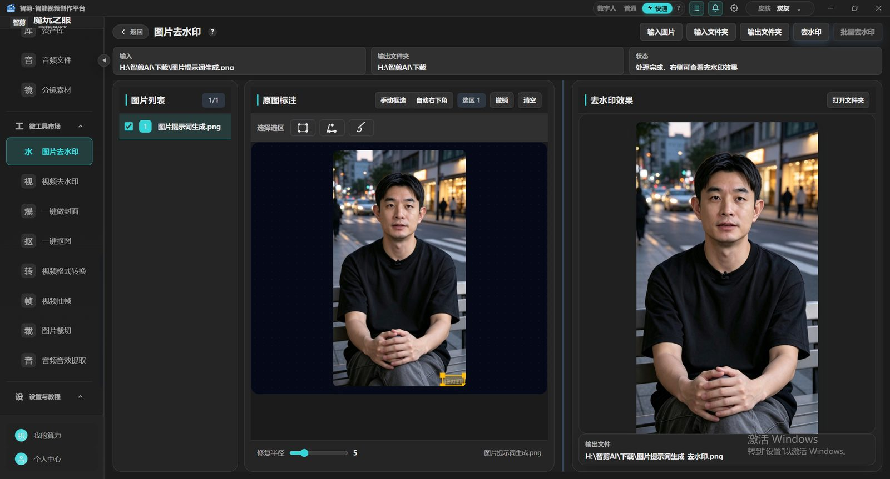
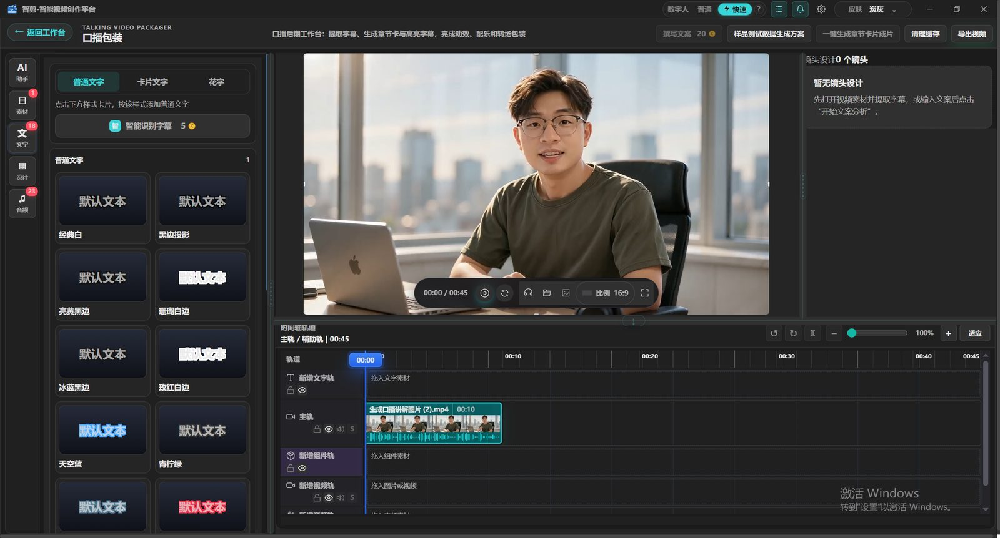

# image-watermark-remover



纯 Python 图片去水印小工具。不依赖 GPU、不依赖深度学习模型，只要 `numpy + pillow` 两个包就能跑，单文件命令行即可使用。

> 适合处理：**自己拍摄的图片 / 自己拥有版权的素材** 上的文字水印、Logo、半透明角标、日期戳等。
> 请勿用于去除他人版权水印后二次传播，后果自负。

## 三种去水印思路

| 模式 | 命令 | 适用场景 |
|---|---|---|
| `inpaint` 区域修复 | `remove_watermark.py inpaint` | 通用。指定矩形 / 遮罩图 / 颜色，把水印区域用周围画面填掉 |
| `invert` 水印反演 | `remove_watermark.py invert` | 手上还有当时加水印用的那张 logo / 水印图，反解出原图，效果最干净 |
| `estimate` 多图中值 | `remove_watermark.py estimate` | 同一画面的多张图、水印位置各不相同（很多平台是随机位置），取中值直接滤掉 |

## 安装

```bash
pip install -r requirements.txt
```

只有两个依赖：`numpy`、`pillow`。可选安装 `opencv-python-headless`，修复速度更快（不装也能跑，自动回退到内置的纯 numpy 算法）。

## 快速开始

```bash
# 1) 右下角有个文字水印？框出来修掉
python remove_watermark.py inpaint -i photo.jpg -o out.png --rect 900,1000,380,60

# 2) 颜色接近纯白的水印？按颜色自动圈出来
python remove_watermark.py inpaint -i photo.jpg -o out.png --color 255,255,255 --tolerance 40

# 3) 手上有当年的水印图（PNG 带 alpha 最佳）？直接反演
python remove_watermark.py invert -i photo.jpg -o out.png -w my_watermark.png

# 4) 一批图水印位置不一样？中值滤波直接滤掉
python remove_watermark.py estimate -i shot1.jpg shot2.jpg shot3.jpg -o clean.png
```

完整演示（自动生成素材并跑完三条路线）：

```bash
python examples/make_sample.py
python examples/demo.py
```

## 参数说明

### inpaint

```
--mask m.png          遮罩图，白色/不透明区域 = 待修复区域
--rect x,y,w,h        矩形区域，可重复传多个（--rect 10,20,300,50 --rect ...）
--color 255,255,255   按颜色自动检测（也支持 #ffffff 写法）
--tolerance 40        颜色容差，默认 40
--dilate 2            遮罩向外扩张圈数，盖住水印的抗锯齿边缘
--radius N            填充半径，默认按遮罩大小自动估计
--no-opencv           强制使用纯 numpy 实现
--save-mask mask.png  把生成的遮罩存出来，先检查遮罩再修复
```

### invert

```
-w watermark.png      水印图，带透明通道的 PNG 效果最好
--alpha 0.3           水印强度 0-1，有 alpha 通道时默认 1.0，否则 0.3
--strength 1.0        整体力度，画面发灰/过冲就调小
```

### estimate

```
-i a.jpg b.jpg ...    同一画面的多张图（建议 >= 3 张，水印位置需不同）
--save-offset o.png   把第一张的残差存出来，检查水印残留
```

## 在代码里调用

```python
from watermark_remover import imread, imwrite, inpaint, build_mask

img = imread("photo.jpg")
mask = build_mask(img, rects=[(900, 1000, 380, 60)], dilate_iters=3)
imwrite("out.png", inpaint(img, mask))
```

## 原理一句话

* **inpaint**：归一化卷积——把已知像素按距离加权平均，一层层往遮罩里扩散，半径从大到小多尺度细化；装了 OpenCV 则直接用 Telea 算法。
* **invert**：水印叠加满足 `I = (1-a)·O + a·W`，已知 `I`、`W`、`a`，反解 `O = (I - a·W) / (1-a)`。
* **estimate**：水印位置随机时，固定像素点的中值就是干净背景。

## 目录结构

```
├── remove_watermark.py        # 一行命令入口
├── watermark_remover/
│   ├── core.py                # 三种核心算法
│   ├── mask.py                # 遮罩生成（矩形/遮罩图/颜色检测/膨胀）
│   ├── cli.py                 # 命令行参数
│   └── utils.py
├── examples/                  # 生成演示素材 + 三条路线完整演示
└── tests/                     # 单元测试：python -m unittest discover tests
```

## 已知限制

* 大面积、纹理复杂区域的修复是"从周围推算"，无法凭空还原被遮挡的内容；
* `invert` 依赖水印图案和透明度准确，参数不合适会发灰或过冲，可用 `--alpha` / `--strength` 微调；
* `estimate` 要求多张图的水印位置不一致，位置完全相同的多张图无法分离。

---

## 更多免费工具，白嫖到底



觉得有用？这里还有一整箱免费好东西：

* **更多免费小工具，直接白嫖**：[http://mowanyan.com/](http://mowanyan.com/)
* **专业级视频编辑工具「魔玩之眼 智剪AI」**：一句话成片、智能剪口播、数字人、批量混剪……来 [魔玩之眼 智剪AI](http://mowanyan.com/) 了解更多白嫖内容，白嫖党直接冲！

觉得这个仓库有帮助的话，点个 Star ⭐ 就是最大的支持。
